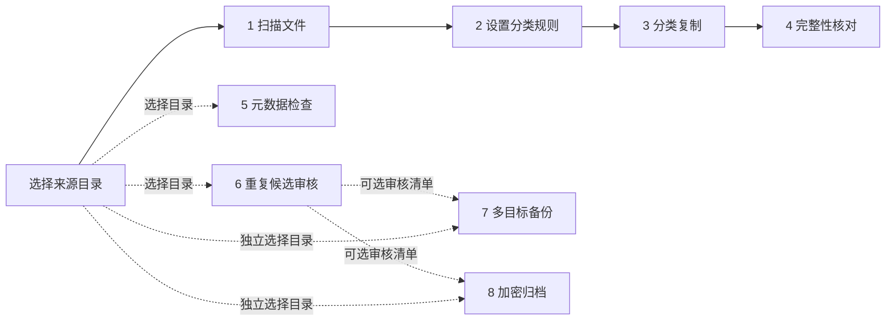
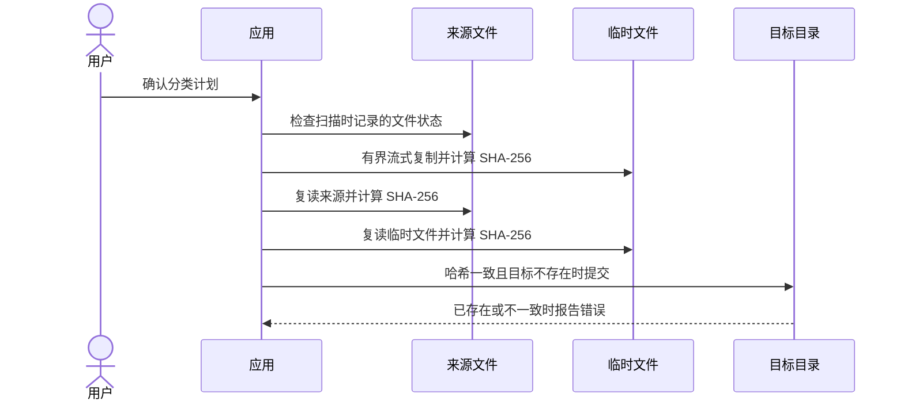
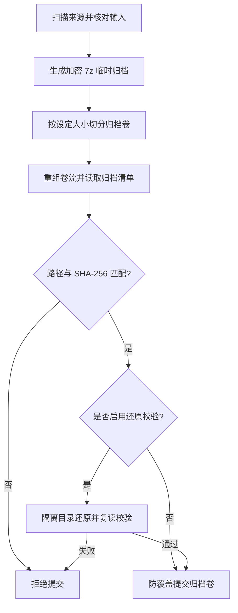

# 技术设计

本文概述应用的数据流和文件安全边界。各阶段的详细实现、验证证据与未完成事项见[实施状态](implementation-status.md)和[发布说明](release.md)。

## 阶段与数据关系

底部导航允许用户进入各阶段；下图中的虚线表示可选地携带审核清单，不代表阶段必须按顺序执行。

扫描结果和任务状态通常只保留在当前会话。分类复制、备份映射、归档输入以及重复审核清单可通过本机检查点恢复；密码和旧的成功校验状态不会随检查点保存。恢复任务会重新读取文件并检查内容。

## 分类复制与覆盖保护

原件不会被移动或删除。复制先写入目标目录中的临时文件；只有来源、临时文件内容一致且目标路径可安全提交时，才提交最终文件。失败时不以覆盖已有文件的方式重试。

## 加密归档校验

归档恢复时需要重新输入密码，并从头扫描、生成和验证归档。分卷写入和隔离目录还原会使用额外临时空间；具体限制及平台验收情况见[发布说明](release.md)。

## 相关文档

- [实施状态与测试证据](implementation-status.md)
- [构建、发布状态和已知限制](release.md)
- [目标设备验收清单](acceptance-checklist.md)
