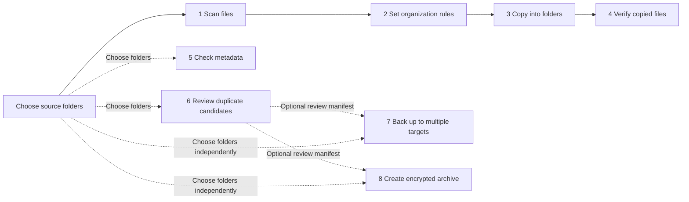
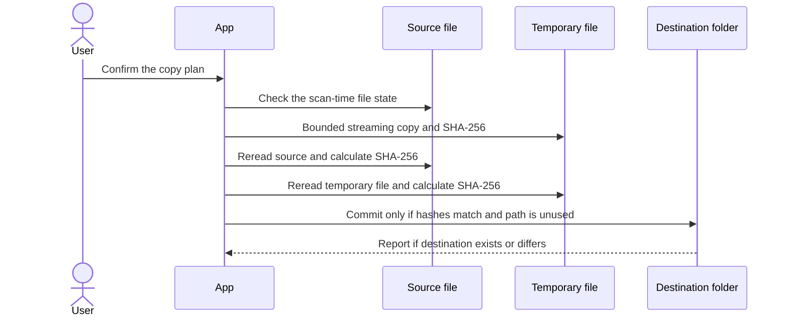
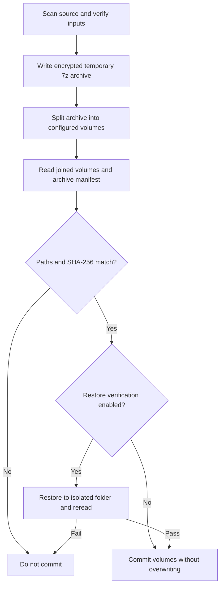

# Technical design

**English | [简体中文](technical-design.zh-CN.md)**

This page describes the data flow and file-safety boundaries. See [implementation status](implementation-status.md), [release guide](release.md), and the [acceptance checklist](acceptance-checklist.md) for evidence and remaining work.

## Workflow and data flow

The bottom navigation lets users open a stage directly. Dashed arrows show optional transfer of a review manifest; stages do not have to run in sequence.

Scans and task status usually live only in the current session. Private local checkpoints can restore an unfinished organization copy, backup mapping, archive inputs, or duplicate-review manifest. They do not store archive passwords or old success results. Resumed work rereads files and verifies their current contents.

## Organization copy and overwrite protection

Originals are not moved or deleted. A copy is first written to a temporary file in the destination folder. The app commits it only after source and temporary-file contents match and the destination can be created safely. It will not retry a failure by overwriting an existing file.

## Encrypted archive verification

Restoring an interrupted archive task requires entering the password again; the app rescans, rebuilds, and verifies the archive from the beginning. Volume splitting and isolated restore checks need extra temporary disk space. See the [release guide](release.md) for limits and platform acceptance status.

## Related pages

- [Implementation status and verification](implementation-status.md)
- [Build, release status, and known limits](release.md)
- [Clean-machine acceptance checklist](acceptance-checklist.md)
