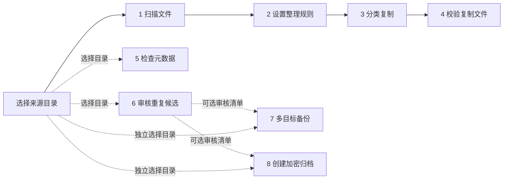
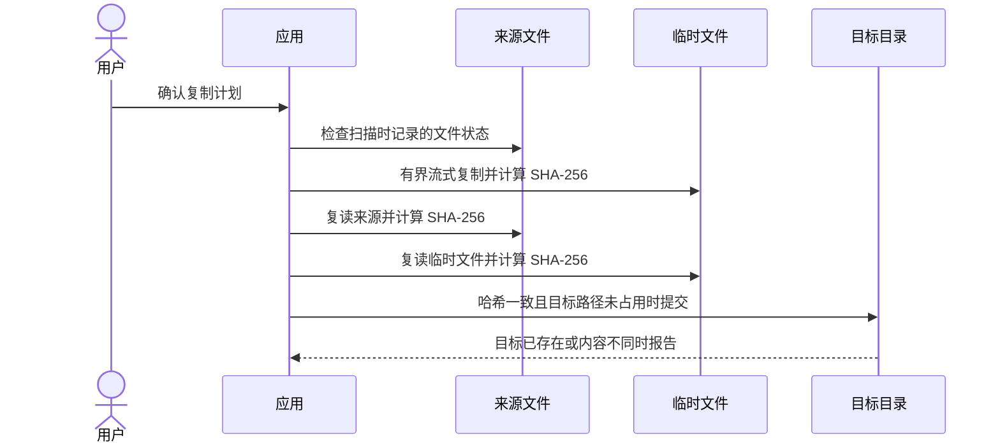
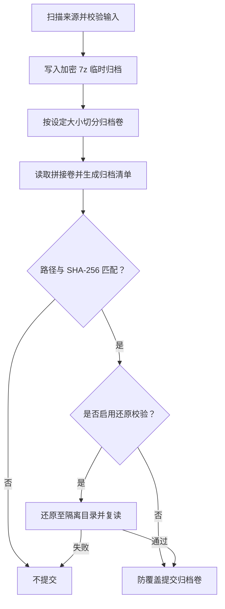

# 技术设计

**[English](technical-design.md) | 简体中文**

本文介绍数据流和文件安全边界。验证证据与待完成事项见[实施状态](implementation-status.zh-CN.md)、[发布说明](release.zh-CN.md)和[验收清单](acceptance-checklist.zh-CN.md)。

## 工作流程与数据关系

底部导航允许用户直接进入任意阶段。虚线表示可选地传递审核清单；阶段不必按顺序执行。

扫描结果和任务状态通常只保留在当前会话。本机私有检查点可恢复未完成的分类复制、备份映射、归档输入或重复审核清单。检查点不会保存归档密码或旧的成功结果。恢复后会重新读取文件并检查当前内容。

## 分类复制与覆盖保护

程序不会移动或删除原件。复制先写入目标目录中的临时文件；只有来源与临时文件内容一致且目标可以安全创建时，才提交最终文件。失败后不会通过覆盖已有文件重试。

## 加密归档校验

恢复中断的归档任务时，需要重新输入密码；程序会从头扫描、重建并校验归档。分卷和隔离还原校验需要额外临时空间。限制和平台验收状态见[发布说明](release.zh-CN.md)。

## 相关文档

- [实施状态与验证记录](implementation-status.zh-CN.md)
- [构建、发布状态和已知限制](release.zh-CN.md)
- [干净设备验收清单](acceptance-checklist.zh-CN.md)
